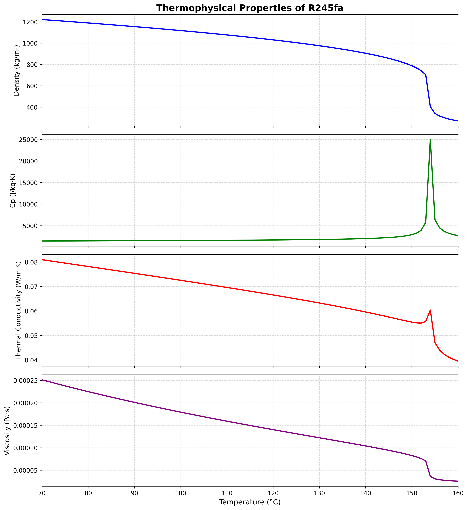

# Thermophysical Property Analysis of R245fa

## Project Overview

This project presents a computational analysis of the thermophysical properties of **R245fa (1,1,1,3,3-pentafluoropropane)** using Python and the CoolProp thermophysical property library.

The study investigates the variation of four important thermophysical properties with temperature at a specified pressure of **36.51 bar (3.651 MPa)** over a temperature range of **70°C to 160°C**.

The calculated properties are exported into an Excel spreadsheet and visualized using Python. The project demonstrates the application of scientific computing and thermophysical property modeling in thermal engineering.

## Objectives

- Calculate the thermophysical properties of R245fa at a specified pressure.
- Investigate the variation of fluid properties with temperature.
- Generate a structured dataset for further engineering analysis.
- Visualize the calculated properties using Python.
- Demonstrate the use of CoolProp for thermophysical property calculations.

## Thermophysical Properties

The following four properties are calculated:

1. **Density** (kg/m³)
2. **Specific Heat Capacity, Cp** (J/kg·K)
3. **Thermal Conductivity** (W/m·K)
4. **Dynamic Viscosity** (Pa·s)

## Methodology

The calculations are performed using Python with the CoolProp property database.

The calculation conditions are:

| Parameter | Value |
|---|---:|
| Working fluid | R245fa |
| Pressure | 36.51 bar |
| Pressure | 3.651 MPa |
| Temperature range | 70°C–160°C |
| Number of temperature points | 91 |
| Temperature interval | 1°C |

Temperature values are converted from Celsius to Kelvin before being used in the property calculations.

CoolProp's `PropsSI` function is used to obtain the following properties:

- Density: `D`
- Specific heat capacity: `Cpmass`
- Thermal conductivity: `conductivity`
- Dynamic viscosity: `viscosity`

The calculated results are organized into a Pandas DataFrame and exported to an Excel file for further use.

## Results and Visualization

The following figure illustrates the temperature-dependent variation of the four calculated thermophysical properties of R245fa at 36.51 bar.



The figure contains four aligned plots:

- Density versus temperature
- Specific heat capacity versus temperature
- Thermal conductivity versus temperature
- Dynamic viscosity versus temperature

A pronounced variation in specific heat capacity is observed in the near-critical temperature region. This behavior makes it important to consider the temperature-dependent properties when performing thermal system analysis.

## Project Structure

```text
R245fa-Thermophysical-Properties/
│
├── README.md
├── R245fa_Property_Analysis.ipynb
├── R245fa_Supercritical_Properties.xlsx
├── R245fa_Thermophysical_Properties.png
├── requirements.txt
└── .gitignore
```

## Technologies and Libraries

- Python
- Jupyter Notebook
- CoolProp
- NumPy
- Pandas
- Matplotlib
- OpenPyXL

## How to Run the Project

### 1. Clone the repository

```bash
git clone https://github.com/dhar000/R245fa-Thermophysical-Properties.git
```

### 2. Navigate to the project directory

```bash
cd R245fa-Thermophysical-Properties
```

### 3. Install the required libraries

```bash
pip install -r requirements.txt
```

### 4. Run the Jupyter Notebook on Colab


Open `R245fa_Property_Analysis.ipynb` and run the notebook cells.

The notebook calculates the thermophysical properties and exports the results to an Excel spreadsheet.

## Applications

The calculated thermophysical properties can be useful for:

- Thermal system modeling
- Heat exchanger analysis
- Refrigeration and organic Rankine cycle studies
- Thermodynamic simulations
- Engineering calculations involving R245fa

## Notes and Limitations

- The results are based on the CoolProp property model and the specified calculation conditions.
- The pressure is held constant throughout the temperature sweep.
- The temperature range includes the near-critical region of R245fa. The thermodynamic state should therefore be interpreted with reference to both pressure and temperature.
- The results are computational predictions and have not been independently validated against experimental measurements in this project.

## Author

Tonmoy Dhar

Engineering Student | Quantum Computing | Heat Transfer | Thermodynamics | Computational Analysis

## Acknowledgment

This project uses [CoolProp](https://coolprop.org/), an open-source thermophysical property library.